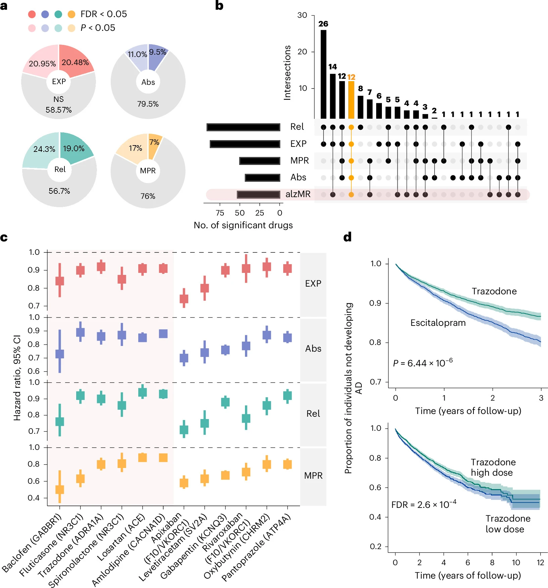

## Citation
```bibtex
@article{hou2026alzheimer,
author={Hou, Yuan and Li, Yichen and Zhang, Pengyue and Lorincz-Comi, Noah and Gohel, Dhruv and Fan, Fan and Qiu, Yunguang and Yang, Jun and Chen, Xin and Song, Wenqiang and Yang, Xiaoyu and Tan, Zhibing and Liu, Zhigang and Fang, Xing and Rivera Paz, Isabela and Martin, William and Feng, Yayan and Zhou, Yadi and Xu, Jielin and Dou, Lijun and Border, Jane and Zhang, Huawei and Mazique, Jena' N. and Hwang, Sung Hee and Roman, Richard J. and Babak, Tousi and Bekris, Lynn and Karavani, Ehud and Danziger, Michael and Rosen-Zvi, Michal and Haines, Jonathan L. and Yu, Haiyuan and Hammock, Bruce D. and Leverenz, James B. and Pieper, Andrew A. and Cummings, Jeffrey and Cheng, Feixiong},
title={Alzheimer's disease target and drug discovery by leveraging multiomics and electronic health data},
journal={Nature Neuroscience},
year={2026},
month={Oct},
day={08},
publisher={Nature Publishing Group US New York},
issn={1546-1726},
doi={10.1038/s41593-026-02472-0},
url={https://doi.org/10.1038/s41593-026-02472-0}
}
```

